<a href="https://omarhussein.com">
  <picture>
    <source media="(prefers-color-scheme: dark) and (max-width: 640px), (prefers-color-scheme: dark) and (min-width: 768px) and (max-width: 940px)" srcset="assets/cover-phone-dark.svg">
    <source media="(max-width: 640px), (min-width: 768px) and (max-width: 940px)" srcset="assets/cover-phone-light.svg">
    <source media="(prefers-color-scheme: dark)" srcset="assets/cover-dark.svg">
    
  </picture>
</a>

I'm a software engineer. I make the technical calls for founders and product teams and ship the software with AI. I've spent 10+ years shipping production software, mostly mobile apps and their backends.

Nearly all of my code is in private repositories, so this page is about the decisions behind that work. The code I can show is [further down](#in-public).

### A few decisions I've made

**I moved two native apps onto one codebase, and releases never stopped.** 
A US consumer fintech had an iOS app in Swift and a separate Android app in Kotlin. Freezing releases for a rewrite wasn't an option, so I moved both onto one Flutter codebase piece by piece, by hand. The app has 200k+ active users today, and the company's annual revenue has grown from $1M to $4M+ while I've been the lead engineer on the app. [How I did it](https://omarhussein.com/blog/swift-and-kotlin-to-one-flutter-codebase)

**I started session handover and built it: scan a QR code, and your Claude or Codex session moves over.** 
Cosyra puts AI coding agents on your phone, and it's client work. I architected how the terminal and the backend talk, and the chat end to end, and I built most of the chat. I ran the backend and led the front-end team of three, and the wider team built the rest. It's live on both stores. Go was new to me, and my first PR shipped on day one. [Read the case study](https://omarhussein.com/work/cosyra)

**I built the core modules once, as a shared package, and four apps were built on it.** 
Jawahr is a hiring app, Ozee is salon and spa booking, Waqfy was a government project for donating to nonprofits, and QSalary is earned-wage access.

**I laid the foundation myself and handed the feature work to three engineers.** 
On Al Habib ePharmacy I set the architecture and the design pattern, built the tricky nested filters, and owned performance, lazy loading, state and caching. The engineers built the features and reported to me. It's live, and I've since passed it on.

**I'd never built video streaming or calls, so I researched it and gave the client options.** 
Then I built it: live sessions, scheduling, a calendar and paid subscriptions. Skols was an app for booking consultants.

**I shut down my own first project.** 
Osbooha 180 was a reading community app, and I did all of it, from requirements through app store testing. Then the plan changed to giving away paid books as free PDFs. I wasn't willing to do that, so I ended it with the shareholders.

I've led teams of three and four, and I've mentored 10+ engineers. [All 29 projects](https://omarhussein.com/work) are on my site.

### How I work

Anything that touches money, auth or user data gets a person reading every line. I wrote down what I still decide myself in [this post](https://omarhussein.com/blog/agents-write-the-code), and there's more on [the blog](https://omarhussein.com/blog).

These days I work in whatever language and stack the problem needs. So far that's been Flutter and Dart, Swift and Kotlin on the apps, with Go, Firebase and Supabase behind them. When something's new to me, I research it and learn it on the job.

### In public

<a href="https://omarhuss.github.io/holo-sticker/">
  <picture>
    <source media="(max-width: 640px), (min-width: 768px) and (max-width: 940px)" srcset="assets/holo-sticker-phone.webp">
    
  </picture>
</a>

- **[holo-sticker](https://github.com/omarhuss/holo-sticker)** is a holographic sticker you can tilt, drawn in one WebGL2 fragment shader. [Tilt it yourself](https://omarhuss.github.io/holo-sticker/), ideally on a phone.
- Bugs I've reported upstream: a terminal rendering regression in [opencode](https://github.com/anomalyco/opencode/issues/29802) and a text-shaping bug in [Flutter](https://github.com/flutter/flutter/issues/46156).
